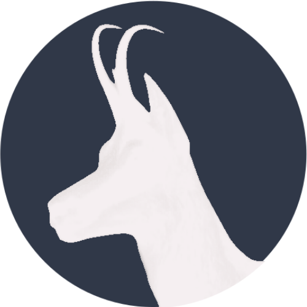

# LifeGoats

The website of Life Goats, a community and event series for people-centred professionals who value relationship building and spending quality time together in the great outdoors.

### The challenge:
Create a captivating website that presents the community and its events - past retreats, upcoming plans, the team and ways to get in touch - providing users with a visually appealing and engaging experience.

### My solution:
A responsive and accessible website that introduces the community and its values, gives each retreat on Mount Olympus its own page (overview, details, route altimeter and photo gallery), and makes it easy to get in touch or subscribe to the newsletter.


## Website Link

You can visit the live website here:

[Live Website Link](https://www.lifegoats.com)


## Logo




## Roadmap

- Develop a server to facilitate user authentication, enabling a streamlined process for individuals to secure their spot at future events.


## Run Locally

This project is built with [Next.js](https://nextjs.org/) and uses Node.js 24 (see `.nvmrc`).

Clone the project:

```bash
  git clone https://github.com/AnastasiaAdamoudi/LifeGoats
```

Go to the project directory:

```bash
  cd LifeGoats
```

Install dependencies:

```bash
  npm install
```

Create a `.env.local` file with the EmailJS keys used by the contact form:

```bash
  NEXT_PUBLIC_EMAILJS_SERVICE_CODE=your-service-id
  NEXT_PUBLIC_EMAILJS_TEMPLATE_CODE=your-template-id
  NEXT_PUBLIC_EMAILJS_USER_ID=your-public-key
```

Start the development server:

```bash
  npm run dev
```

Open [http://localhost:3000](http://localhost:3000) to view it in your browser.

Other scripts:

```bash
  npm run build   # production build
  npm run start   # serve the production build
```


## Project Structure

```
app/          Next.js App Router pages, plus the components in app/components
data/         Content for the pages (events, team, testimonials, galleries, navigation)
motion/       Framer Motion animation variants
providers/    Shared React state and the reduced-motion setup
public/       Static files (icons, sitemap, robots.txt, archived newsletters)
src/assets/   Images and SVG icons
src/scss/     All the styles (see below)
```


## Styling

All styles are written in SCSS and live in `src/scss/`, never next to the components:

```
src/scss/
  styles.scss     Global entry point, imported once from app/layout.jsx
  globals/        Theme colours, design tokens, reset, accessibility rules and mixins
  components/     One stylesheet per component, mirroring app/components
  pages/          Stylesheets for the route pages
```

- **BEM class names**, e.g. `.event-card`, `.event-card__title`, `.event-card--link`.
- **Colours** are CSS custom properties in `globals/_themes.scss`, used through `vars.color(primary)`.
- **Font sizes, spacing and line heights** are tokens in `globals/_variables.scss`, used through `vars.font-size(lg)`, `vars.space(md)` and `vars.line-height(normal)`. Font sizes and spacing scale smoothly with the screen width between mobile and desktop.
- **Mixins** in `globals/mixins/` cover breakpoints, section headings, gradients and single-colour icons (drawn with a CSS mask so their hover colour comes from the theme).
- Components import their stylesheet directly, e.g. `import "@/src/scss/components/Events/EventCard.scss";`.


## Newsletter

Newsletter sign-ups are managed with [Kit](https://kit.com/):

- `app/subscription-to-newsletter` - sign-up page with the embedded Kit form
- `app/subscription-to-newsletter/successful` - shown after signing up
- `app/subscription-to-newsletter/confirmed` - shown after confirming the subscription

Past newsletters are archived at `app/newsletter/december-2024`, `public/newsletters/newsletter-january-2025.html` and `public/newsletters/newsletter-march-2025.html`.


## Accessibility

The site aims to meet WCAG 2.2 level AA: keyboard-accessible menus and pop-ups, a skip link, visible focus outlines, labelled form fields, colour contrast of at least 4.5:1 for text, and reduced motion for visitors who ask for it. The current status and known limitations are published on the [Accessibility Statement](https://www.lifegoats.com/accessibility-statement) page.


## Tech Stack

**Design:** Canva, GIMP

**Collaboration:** Trello

**Development:** Next.js, React.js, SCSS (Sass), Framer Motion, Chart.js, PrimeReact, EmailJS
